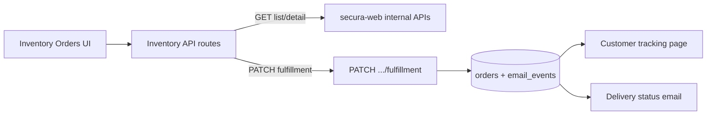

# Admin Orders Fulfillment Requirements

## Context

From [guest-checkout delivery email spec](secura-web/docs/superpowers/specs/2026-08-27-guest-checkout-delivery-email-automation-spec.md):

- Full admin UI was deferred in v1 (“use Supabase or protected internal endpoint”).
- **Milestone 7** is the source of truth for ops: manually update fulfillment → customer tracking page updates → one status email queued.
- Decision locked: build this in **inventory management**, **fulfillment-only** (no quote handling, no email-outbox UI).

Already implemented in **secura-web** (reuse, do not reimplement):

- Status lifecycle and labels in [`utils/orders-server.ts`](secura-web/utils/orders-server.ts)
- `PATCH /api/internal/orders/[orderId]/fulfillment` ([route](secura-web/app/api/internal/orders/[orderId]/fulfillment/route.ts)) — auth via `SECURA_INTERNAL_API_TOKEN`
- Idempotent email queuing on status change; tracking fields only valid when `dispatched`
- Customer tracking page at `/orders/[orderId]`

**Gap:** inventory app has no Orders UI; orders RLS only lets customers see their own rows, so the browser publishable client cannot list all orders.

## Fulfillment status model (canonical)

Ops may set one of:

| Status | Admin meaning |
|--------|----------------|
| `pending` | Created; payment not confirmed |
| `payment_confirmed` | Paid; ready to prepare |
| `preparing` | Packing / staging |
| `dispatch_scheduled` | Pickup/dispatch planned |
| `dispatched` | With courier; may include tracking |
| `delivered` | Complete |

Rules already enforced server-side (dashboard must respect in UI):

- Tracking (`tracking_provider`, `tracking_reference`, `tracking_url`) only when status is `dispatched`
- Same status re-save with no tracking change → no duplicate email
- Status change → queue one customer email; `dispatched` also triggers immediate outbox process

## Requirements map (spec → dashboard)

### R1 — Review: order list

- New nav item **Orders** in inventory sidebar (do not overload stub Pre-orders; those are a different table).
- Table of customer `orders` with at least: order id (short), created date, customer name/email/phone snapshots, delivery zone/label, payment `status`, `fulfillment_status`, total amount.
- Default filter: paid work queue — `status = confirmed` (and optionally include `quote_required` as read-only rows without status edit if useful; **edits stay fulfillment-only**).
- Filter by `fulfillment_status`; simple search by email/name/order id.
- Sort newest first.

### R2 — Review: order detail

- Detail view/panel showing:
  - Contact snapshot: name, email, phone
  - Delivery: address, zone label, delivery fee, installation fee, subtotal, total
  - Line items: product name, qty, unit price, line total
  - Payment status + reference (read-only)
  - Current fulfillment status + last `fulfillment_updated_at`
  - Existing tracking fields when present
- Read-only for payment and pricing; no cancel/refund/quote actions in this scope.

### R3 — Update: fulfillment status

- Control to set next/any allowed fulfillment status from the canonical list.
- On save, call existing secura-web fulfillment endpoint (via inventory BFF) — **never** update `orders` directly from the client (would skip email outbox).
- Show success/error; refresh detail after update.
- Confirm when moving to `delivered` (irreversible ops habit; soft confirm is enough).

### R4 — Update: courier details on `dispatched`

- When selected status is `dispatched`, show fields: courier name (`tracking_provider`), reference, tracking URL.
- Allow update of tracking fields while remaining `dispatched` without re-queueing email if status unchanged (server already does this).
- Clear/disable tracking inputs for non-`dispatched` statuses.

### R5 — Auth and security

- Reuse inventory login + middleware cookie guard.
- Internal token and any service-role usage stay **server-only** in inventory API routes (`SECURA_INTERNAL_API_TOKEN`, `SECURA_WEB_BASE_URL`).
- No new public order write APIs from the browser.

### R6 — Acceptance criteria (from Milestone 7, admin-facing)

- Changing status in admin updates the customer order tracking page.
- Setting `dispatched` with courier name/reference/URL persists and shows on tracking.
- Each status change results in one customer delivery email; identical re-save does not duplicate.
- Unauthorized requests cannot list or update orders.

## Out of scope (explicit)

- Quote-required fee setting / payment collection
- Email outbox retry UI
- Editing payment `status`, cancellations, refunds
- Courier API integrations
- Customers page / Pre-orders page (stubs remain)

## Implementation approach

### secura-web (small API additions)

Add protected internal read endpoints mirroring fulfillment auth:

- `GET /api/internal/orders` — paginated list + filters (`fulfillmentStatus`, `status`, `q`)
- `GET /api/internal/orders/[orderId]` — order + `order_items`

Keep writes on existing `PATCH .../fulfillment`.

### inventory management (UI + BFF)

- Wire sidebar **Orders** → `/orders`
- Pages: list + detail (or list with detail drawer; prefer dedicated `/orders/[orderId]` to match product patterns)
- `src/api/orders.ts` + types for list/detail/update
- Next.js route handlers under `src/app/api/orders/...` that proxy to secura-web with the internal token
- Reuse existing dashboard visual language (white cards, blue primary, dense tables)

### Config

Inventory env:

- `SECURA_WEB_BASE_URL` (e.g. production/staging storefront origin)
- `SECURA_INTERNAL_API_TOKEN` (same secret as secura-web)

## Key files to touch

| Repo | Files |
|------|--------|
| secura-web | New `app/api/internal/orders/route.ts`, `app/api/internal/orders/[orderId]/route.ts`; reuse `orders-server` helpers |
| inventory | [`Sidebar.tsx`](secura inventory management/src/components/layout/Sidebar.tsx), new `app/orders/*`, `api/orders.ts`, `types/orders.ts`, BFF `app/api/orders/*` |

## Suggested build order

1. Internal list + detail APIs on secura-web (+ tests like existing fulfillment route tests)
2. Inventory BFF proxy routes + env wiring
3. Orders list UI
4. Order detail + status/tracking update form
5. Manual acceptance against a paid test order (tracking page + email outbox row)
